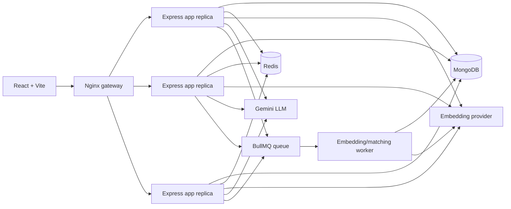

# AI Resume-to-Job Matching Engine

## Problem statement

Candidates apply blindly because keyword search misses equivalent wording, and
recruiters manually skim large resume pools without a consistent ranking. This
project converts resumes and jobs into embeddings, ranks them with cosine
similarity, and explains only the top matches in plain language. The ranking
does not require an LLM; AI is used for embeddings and optional explanations,
while caching, rate limiting, queues, load balancing, and circuit breaking
make those calls affordable and resilient.

## Architecture



## Request flow

1. The client sends `X-Tenant-Id` and a user identity selector.
2. Express resolves tenant context once, applies Helmet/CORS/body limits,
   validation, request IDs, and Redis token-bucket rate limiting.
3. Resume/job content is hashed and embedded. Duplicate content in the same
   tenant reuses the existing document.
4. Matching retrieves tenant-scoped documents and ranks embeddings with pure
   cosine similarity. No LLM is needed for ranking.
5. For `explain=true`, the top `explainTop` results use the exact or semantic
   Redis explanation cache before calling Gemini.
6. If Gemini fails or the circuit is open, a deterministic fallback explanation
   is returned and ranking still succeeds.
7. Usage, request timings, sources, and estimated costs are persisted for the
   dashboard and stats API.

## Feature list and why each exists

| Feature | Why it exists |
|---|---|
| Embeddings and cosine ranking | Finds meaning-based matches beyond exact keywords. |
| Keyword skill extraction | Supplies transparent matched/missing skill facts without an extra AI call. |
| Retrieved-facts-only explanations | Makes the score understandable while reducing hallucination risk. |
| Exact and semantic Redis cache | Avoids repeated explanation calls for unchanged or near-duplicate content. |
| Atomic Redis rate limiter | Controls per-user AI spend during normal use and bursts. |
| Circuit breaker and fallback | Keeps ranking available when the LLM is slow or unavailable. |
| BullMQ worker | Moves bulk embedding and re-matching out of the request path. |
| MongoDB tenant-scoped persistence | Keeps resumes, jobs, matches, and usage durable and isolated. |
| Nginx least-connection gateway | Distributes requests across app replicas and skips failed instances. |
| Usage dashboard | Shows request latency, cache savings, calls, fallbacks, and estimated cost. |

## Tech stack

React/Vite, Node.js 20+, Express, Mongoose/MongoDB 7, Redis 7 with ioredis,
BullMQ, Nginx, Docker Compose, Gemini for explanations, and Ollama-compatible
embeddings by default. Tests use Vitest and Supertest; load tests use k6.

## Run locally with Docker

Create `backend/.env` from `.env.example` and provide the Gemini key and
embedding configuration. The default container setup expects Ollama on the host
at `host.docker.internal:11434`; pull the configured embedding model first.

```powershell
docker compose up --build --scale app=3
```

Open `http://localhost`. The API is behind Nginx at `/api`, and `/health`
reports MongoDB, Redis, breaker state, and fallback diagnostics.

Useful commands:

```powershell
docker compose run --rm app npm run seed
docker compose ps
docker compose logs -f app
```

The app is stateless for durable correctness: MongoDB stores application data,
Redis stores cache/rate-limit/queue state, and the worker is separate. Breaker
state and fallback counters are process-local diagnostics and are not global
metrics.

## API examples

```powershell
curl.exe -H "X-Tenant-Id: tenant-acme" http://localhost/api/jobs
curl.exe -H "X-Tenant-Id: tenant-acme" `
  "http://localhost/api/resumes/<resume-id>/matches?explain=true&explainTop=3"
curl.exe -H "X-Tenant-Id: tenant-acme" `
  "http://localhost/api/stats?range=24h"
```

Admin bulk work returns `202` and is polled through
`GET /api/admin/jobs/:jobId`; run the worker with `npm run worker` outside
Compose when developing directly.

## Load tests and measured results

The k6 scenarios are in [loadtest/](./loadtest/):

- `scenario-a-cold.js`: flush Redis first, then matching with explanations.
- `scenario-b-warm.js`: repeat the same traffic without flushing Redis.
- `scenario-c-rate-limit.js`: one fixed user identity at burst rate.
- `scenario-d-llm-failure.js`: matching while `LLM_FORCE_FAILURE=true`.

Run them with Dockerized k6:

```powershell
docker compose up -d --scale app=3
docker compose exec -T redis redis-cli FLUSHALL
docker run --rm -i -v "${PWD}\loadtest:/scripts" grafana/k6:latest run `
  -e TENANT_ID=tenant-acme -e RESUME_ID=<resume-id> `
  /scripts/scenario-a-cold.js
```

The complete measured table, parameters, and the warm-cache limitation are in
[docs/BENCHMARKS.md](./docs/BENCHMARKS.md).
The recorded run achieved 0% HTTP errors for cold/failure matching, 96.67%
errors in the deliberate one-user burst due to 429 responses, and 0% cache
hits because the configured LLM was falling back during the run. No benchmark
number is estimated or hardcoded.

## Design tradeoffs

- **In-process vector search** keeps the demo simple and makes tenant filtering
  explicit, but scans candidate documents and will not meet large-scale
  latency without a vector index.
- **Redis semantic cache** is bounded and inexpensive, but its linear
  near-duplicate scan is not a general vector database.
- **Synchronous single matching** gives an immediate user result; bulk work is
  asynchronous because it can touch many documents and provider calls.
- **Fallback explanations** sacrifice prose quality during outages to preserve
  ranking availability and predictable failure behavior.
- **Header-based tenants** demonstrate isolation but are not authentication.
  Production must use a verified identity claim.
- **Docker Compose** makes the architecture reproducible locally, but it is not
  a production orchestrator or a multi-region deployment.

## Known limitations

- No real authentication or authorization; clients can choose the demo tenant
  header.
- Embedding search is an in-app scan rather than a vector database/index.
- Breaker state is per process, not globally aggregated across replicas.
- Provider availability and model quality depend on external Gemini/Ollama
  configuration.
- Cost values are estimates from configured prices and token usage.
- The benchmark was run on one local Docker host and is not a capacity claim.

## Future work

Introduce authenticated tenant claims, a filtered vector database, centralized
metrics/tracing, Redis Cluster, durable provider budgets, batch embeddings,
stronger audit logging, managed deployment, and a broader reproducible
benchmark matrix across payload sizes and replica counts.

For interview-oriented explanations of the implementation, see
[docs/INTERVIEW_NOTES.md](./docs/INTERVIEW_NOTES.md).
